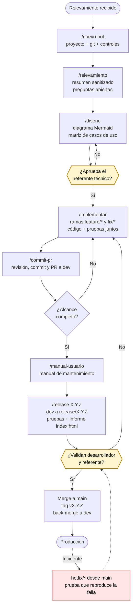

# Ciclo de implementación

Cinco fases. Lo que no está escrito en el repositorio no ocurrió: cada fase termina en un artefacto concreto.

## Fase 0 — Alta del proyecto

`/nuevo-bot <nombre>` crea el proyecto desde `plantilla-bot/`, inicializa git con `main` y `dev`, instala el control previo al commit y abre la bitácora con su primera entrada.

## Fase 1 — Relevamiento y diseño

`/relevamiento` lee el documento (guardado en `relevamiento/`, ignorada por git) y produce:

- **`docs/relevamiento-resumen.md`** — versión sanitizada: objetivo, alcance, sistemas, entradas y salidas, reglas de negocio, excepciones, volúmenes y parametrizaciones. Con el hash SHA-256 del documento original para trazabilidad.
- **`docs/preguntas-abiertas.md`** — lo que el relevamiento no aclara. Se resuelve con el referente antes de diseñar.

Antes de diseñar, el desarrollador prueba directamente el acceso a cada sistema (con `.env.local` o `.env.dev`, nunca versionados — ver [seguridad.md](seguridad.md)). No hay un checklist aparte para esto: si el acceso no funciona, no se puede diseñar.

`/diseno` produce **`docs/diseno/solucion.md`**: diagrama Mermaid en pseudocódigo con un subgrafo por sistema, módulos y responsabilidades, manejo de errores, idempotencia y la matriz de casos de uso (`CU-001`, `CU-002`, …), que después se convierte en el catálogo de pruebas.

**Se aprueba antes de seguir.** PR de `feature/diseno-inicial` a `dev`; el referente técnico revisa y aprueba vía CODEOWNERS. No se escribe código productivo antes de esa aprobación. La bitácora registra quién aprobó, cuándo y con qué observaciones.

## Fase 2 — Desarrollo

El desarrollador copia `.env.example` como `.env.local` (o `.env.dev` si son credenciales compartidas por el equipo) y completa los valores reales — el bot busca en ese orden y usa el primero que encuentra. Ninguno de los dos se versiona.

Una rama por funcionalidad: `feature/<slug>` para algo nuevo, `fix/<slug>` para un ajuste. Ambas nacen de `dev` y vuelven a `dev`.

Ningún PR sin prueba nueva o actualizada. Antes de cada PR, el agente `revisor-codigo` revisa estándares, secretos, manejo de errores y cobertura respecto del diseño. `/commit-pr` arma el commit y el PR con qué cambia, por qué, qué se probó y qué casos de uso cubre, y deja la entrada en la bitácora.

## Fase 3 — Manual de usuario

`/manual-usuario` genera **`docs/manual-usuario.md`**, dirigido al equipo de mantenimiento: precondiciones, postcondiciones y resultados, parametrizaciones, errores contemplados, errores conocidos y su propia tabla de versiones.

Acá se revisa el diagrama de la solución: si cambió durante el desarrollo, se actualiza `docs/diseno/solucion.md`; si no cambió, se lo declara en la bitácora.

## Fase 4 — Release y evidencia

`/release X.Y.Z`:

1. PR de `dev` a `release/X.Y.Z`.
2. Se completa `docs/pruebas/casos.toml`: cada caso de uso del diseño necesita al menos un caso de prueba.
3. Se ejecuta pytest; los casos automatizados quedan con el resultado real.
4. Los casos manuales se cargan con su evidencia en `docs/pruebas/releases/X.Y.Z/`.
5. Se genera `docs/pruebas/releases/X.Y.Z/index.html`: id, fecha, descripción, funcionalidad probada, resultado esperado y obtenido.
6. `verificar_ciclo.py` chequea que el ciclo esté completo. Si falla, el release no avanza.

**Se valida antes del merge a `main`.** PR de `release/X.Y.Z` a `main` con el informe, el manual y el diagrama actualizados; desarrollador y referente validan antes de aprobar. Al mergear: tag `vX.Y.Z` y back-merge a `dev`, para no perder las correcciones del release.

## Fase 5 — Producción y hotfix

`main` refleja siempre lo que está en producción. Ante un incidente: rama `hotfix/<slug>` desde `main`, con una prueba que reproduce la falla antes de corregirla, PR a `main`, tag y back-merge a `dev`.

## Qué exige cada aprobación

| | Diseño (Fase 1) | Producción (Fase 4) |
|---|---|---|
| Resumen del relevamiento | Obligatorio | — |
| Preguntas abiertas | Resueltas | — |
| Diagrama de la solución | Obligatorio | Actualizado o declarado sin cambios |
| Matriz de casos de uso | Obligatoria | Cubierta al 100% por pruebas |
| Código con pruebas | — | Obligatorio |
| Informe `index.html` | — | Obligatorio |
| Manual de usuario | — | Obligatorio, en la versión del release |
| Bitácora | Al día | Al día, con la entrada del release |
| Aprueba | Referente técnico | Desarrollador + referente |
