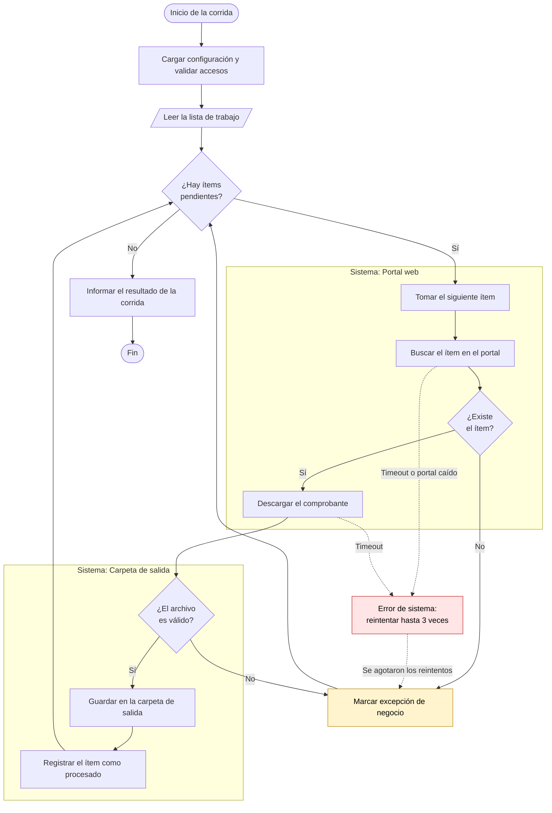

# Diseño de la solución — <NOMBRE_DEL_BOT>

| | |
|---|---|
| **Versión del diseño** | 1.0 |
| **Fecha** | AAAA-MM-DD |
| **Autor** | |
| **Aprobado por** | <referente técnico> |
| **Fecha de aprobación** | AAAA-MM-DD |
| **Basado en** | [Resumen del relevamiento](../relevamiento-resumen.md) |

## Historial del diseño

| Versión | Fecha | Cambio | Motivo |
|---|---|---|---|
| 1.0 | AAAA-MM-DD | Diseño inicial | — |

---

## Diagrama de la solución

Pseudocódigo del flujo. Convenciones del equipo:

- `([texto])` inicio y fin · `[texto]` paso · `{texto}` decisión · `[/texto/]` entrada o salida de datos
- Un **subgrafo por sistema externo**, para ver de un vistazo cuántos sistemas toca el bot.
- Los caminos de excepción se dibujan, no se omiten: son la mitad del trabajo de una automatización.
- Las **excepciones de negocio** (no se reintentan) y los **errores de sistema** (se reintentan) se distinguen con color.

> Reemplazar el ejemplo por el flujo real. `src/paquete_bot/principal.py` debe leerse igual que este diagrama.

## Módulos y responsabilidades

| Módulo | Responsabilidad | Sistema externo |
|---|---|---|
| `principal.py` | Orquesta el flujo del diagrama | — |
| `configuracion.py` | Carga y valida configuración y parametrizaciones | — |
| `conectores/<sistema>.py` | Toda la interacción con ese sistema | |

## Manejo de errores

| Situación | Clasificación | Tratamiento | Reintentos |
|---|---|---|---|
| Portal no responde | `ErrorSistema` | Reintenta y continúa | 3, espera creciente |
| Ítem inexistente en el portal | `ErrorNegocio` | Marca excepción y sigue con el próximo | No |
| Falta una variable de entorno | `ErrorConfiguracion` | Aborta la corrida antes de empezar | No |

## Idempotencia y reanudación

- **Si se ejecuta dos veces sobre el mismo período:** qué mecanismo evita duplicar.
- **Si se cae en el ítem 300 de 500:** desde dónde retoma y cómo sabe qué ya hizo.

## Etapas del proceso

Completar solo si el proceso se separa en etapas que corren por separado (frecuencias distintas, ventanas de disponibilidad distintas, o conviene reintentar una sin repetir la otra). Si el proceso corre de punta a punta en una sola pasada, borrar esta sección.

| Etapa | Qué hace | Frecuencia | Deja pendiente para |
|---|---|---|---|
| | | | |

**Registro que las conecta:** `estado/<nombre>.db` (`RegistroItems`, ver `docs/estandares-python.md` del plugin § Procesos en varias etapas).

## Parametrizaciones

| Parámetro | Archivo | Validación al leerlo | Ejemplo |
|---|---|---|---|
| | `datos/ejemplo/parametros.csv` | | |

## Matriz de casos de uso

Todo caso de uso listado acá **debe tener al menos una prueba** en `docs/pruebas/casos.toml`. El verificador del release lo controla y rechaza la puesta en producción si falta alguno.

| # | Caso de uso | Entrada / condición | Resultado esperado | Origen |
|---|---|---|---|---|
| CU-001 | Procesamiento normal de un ítem válido | Ítem existente con comprobante disponible | Comprobante descargado y guardado en la carpeta de salida | RN-001 |
| CU-002 | Ítem inexistente en el portal | Ítem que no figura en el portal | Excepción de negocio registrada, la corrida continúa | EX-001 |
| CU-003 | Portal caído durante la búsqueda | Timeout del portal | Reintenta 3 veces; si persiste, marca error de sistema | EX-002 |
| CU-004 | Archivo de entrada con columna faltante | CSV sin la columna `destino` | Error claro antes de procesar, la corrida no arranca | RN-002 |
| CU-005 | Corrida sin ítems pendientes | Lista de trabajo vacía | Termina correctamente informando cero ítems | — |

## Decisiones de diseño

| Decisión | Alternativas evaluadas | Por qué esta |
|---|---|---|
| | | |

## Riesgos conocidos

| Riesgo | Impacto | Mitigación |
|---|---|---|
| | | |
